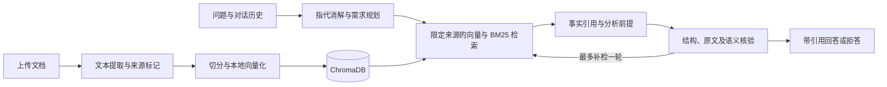

# QASystem · 基于证据的多用户知识库问答系统

基于 FastAPI 的中文 RAG 问答应用，支持私有知识库管理、多轮对话、文档上传，以及本地与云端生成模型切换。系统在检索时保留文档归属，在回答前检查引用与语义支持，减少来源混淆、无依据回答和漏答。

适用于 RAG 学习、课程项目进阶和受控环境中的原型验证。

## 功能与实现

| 能力 | 实现方式 |
| --- | --- |
| 多用户与私有资源 | 注册、登录、管理员用户管理；知识库、会话和 API 配置按用户隔离 |
| 知识库管理 | 创建、编辑、删除与融合；保留融合前的来源边界 |
| 文档读取 | TXT、Markdown、DOCX、文本型 PDF；DOCX 保留段落与表格顺序，PDF 保留物理页码标记 |
| 混合检索 | 本地 BGE 向量化、ChromaDB、中文二元字词 BM25、RRF 排名融合 |
| 多轮问答 | 利用历史消解指代、改写追问、拆分需求，再按授权来源检索；历史不作为事实证据 |
| 基于证据的生成 | 事实引用原文片段；分析结论关联已核验的事实前提；支持部分回答和证据不足时拒答 |
| 有界核验 | 结构与引用校验、同一生成模型的语义核验；最多补检一轮 |
| 双生成后端 | 本地 Transformers 模型与 OpenAI 兼容 API；嵌入与生成解耦 |
| 交互与持久化 | SSE 阶段状态与答案返回；SQLite 保存账号、会话、消息及引用 |
| 评测工具 | 检索指标、独立人工答案评分、API 重放与断点续跑 |

默认使用受控流程，通常调用模型 **3 次**，补检后最多 **5 次**。草稿核验完成后才返回答案，因此首段正文需要等待。`legacy` 模式保留单次检索与逐 token 输出，可通过问答接口的 `pipeline` 参数使用。

## 技术栈与流程

- **服务端**：Python、FastAPI、Pydantic、SQLAlchemy、SQLite。
- **检索与模型**：ChromaDB、LangChain Text Splitters、PyTorch、Transformers、OpenAI SDK。
- **文件与安全存储**：python-docx、pypdf、PBKDF2-SHA256、Fernet。
- **前端**：HTML、CSS、原生 JavaScript，无需 Node.js 构建。



默认嵌入模型为 `BAAI/bge-small-zh-v1.5`，默认本地生成模型为 `Qwen/Qwen2.5-1.5B-Instruct`。当前向量实现采用 mean pooling；默认分块长度为 260 字符、重叠 60 字符，问答 Top-K 为 4。混合检索用于默认受控流程。

## 快速开始

### 1. 安装依赖

推荐 Python **3.12**。以下命令在项目根目录执行。

```bash
python -m venv .venv
```

激活环境：

```powershell
# Windows PowerShell
.\.venv\Scripts\Activate.ps1
```

```bash
# Linux / macOS
source .venv/bin/activate
```

```bash
python -m pip install --upgrade pip
python -m pip install -r requirements.txt
```

依赖清单固定了已验证开发环境中的直接依赖版本，未包含模型权重。PyTorch 依赖较大；使用 NVIDIA GPU 时，可先依据 [PyTorch 安装说明](https://pytorch.org/get-started/locally/)安装与硬件匹配的 2.6.0 构建，再安装其余依赖。CPU 可以运行，但本地生成速度较慢。

### 2. 配置并启动

首次启动前设置管理员密码。应用**不会自动读取 `.env`**；[.env.example](.env.example) 是配置参考，请在启动终端设置环境变量。

```powershell
# Windows PowerShell：将示例值改为自己的强密码
$env:APP_ADMIN_USER = "admin"
$env:APP_ADMIN_PASSWORD = "replace-with-your-own-strong-password"
python -m uvicorn server:app --host 127.0.0.1 --port 8000
```

```bash
# Linux / macOS：将示例值改为自己的强密码
export APP_ADMIN_USER=admin
export APP_ADMIN_PASSWORD='replace-with-your-own-strong-password'
python -m uvicorn server:app --host 127.0.0.1 --port 8000
```

打开 <http://127.0.0.1:8000>。接口文档位于 <http://127.0.0.1:8000/docs>，健康检查为 `GET /api/health`。

未设置管理员环境变量时，开发默认账号为 `admin / admin123`。环境变量只在创建首个管理员时生效；已有账号需要通过管理员界面重置密码。首次启动会后台导入 `data/sample.md` 中的虚构资料，仅管理员可见；其他用户可自行上传。

### 3. 准备模型

模型查找顺序为：环境变量 → 项目 `models/` 或 `model/` 目录中的候选模型 → 默认 Hugging Face 模型 ID。Web 模式在没有本地权重时可能联网下载；离线运行应预先准备完整模型目录。

```powershell
# Windows 示例：路径按实际位置修改
$env:LOCAL_EMBEDDING_MODEL = "D:\models\bge-small-zh-v1.5"
$env:LOCAL_LLM_MODEL = "D:\models\Qwen2.5-1.5B-Instruct"
```

使用云端生成时仍需本地嵌入模型，但无需加载本地生成模型。默认 1.5B 模型可以演示本地模式；复杂需求规划、分析和核验依赖模型的指令与 JSON 输出能力。

### 4. 配置云端生成

登录后在页面的 API 配置中填写服务名称、Base URL、模型名和 API Key，在问答区域切换至 API 模式并选择配置。接口需兼容 OpenAI Chat Completions，所填模型必须在账号中实际可用。

API Key 经过 Fernet 加密后存入本地数据库，界面仅返回脱敏值。选择云端生成后，问题、必要历史及检索证据会发送给该服务。命令行评测的 `DASHSCOPE_*` 环境变量与 Web 页面配置相互独立。

## 文档与来源管理

可上传 `.txt`、`.md`、`.text`、`.docx`、`.pdf`，单文件上限 **20 MB**；PDF 上限 **500 页**，提取文本上限 **200 万字符**。DOCX 还有解压体积限制，PDF 还有单页内容流限制。

- DOCX 支持正文段落、标题和表格，不执行图片 OCR；不保证提取页眉、页脚、文本框及批注。
- PDF 支持可提取的文本层，记录 `第 N 页` 标记；扫描件需先 OCR，加密 PDF 和旧版 `.doc` 不支持。
- 解析失败会在写入前返回错误，不替换已有知识库。运行时保留提取后的文本，不保存上传的原始二进制文档。
- PDF 复杂多栏、特殊字体与表格可能影响阅读顺序，请在导入后检查提取文本。

合并文本或手工上传多份资料时，使用以下来源标记保留归属，避免切片后混淆实体：

```markdown
# 来源文档：甲研究所
甲研究所的资料……

# 来源文档：乙研究所
乙研究所的资料……
```

索引记录文档标识、标题、章节位置和文本指纹。修改原文后应通过页面重新保存以重建索引；原文与索引版本不一致时，受控问答会提示重建。

## 评测与测试

本发布版保留 **12 道虚构机构诊断题**，覆盖事实归属、多证据、追问、分析边界与拒答。参考标注为助手草稿，待独立人工审核；仅用于复现开发流程，不代表正式测试成绩。

```bash
# 校验原文指纹、证据位置与数据格式，无模型调用
python -B rag_evaluation.py validate

# 46 项核心回归测试；模型调用为 Mock，无需下载模型或填写 API Key
python -m pip install -r requirements-dev.txt
python -B -m unittest discover -s tests -v
```

检索基线评测要求设置 `LOCAL_EMBEDDING_MODEL` 为已下载的本地目录，不自动下载权重：

```bash
python -B rag_evaluation.py run --ks 1 2 4 8 --answer-top-k 4 --device cpu --output kb_store/evaluation/baseline
```

`run` 使用基础向量检索，便于建立对照；`run-controlled` 才执行与默认应用对应的混合检索和核验流程。云端受控评测先在终端设置 `DASHSCOPE_API_KEY`、`DASHSCOPE_BASE_URL`，再执行：

```bash
# 将 your-model-id 替换为服务中实际可用的模型；会产生 API 费用
python -B rag_evaluation.py run-controlled --api-model your-model-id --ks 1 2 4 8 --answer-top-k 4 --max-new-tokens 1536 --device cpu --output kb_store/evaluation/controlled
```

检索指标包括 Hit@K、MRR@K、Evidence Recall@K 和 All Evidence@K。答案评分分别记录 `answer_correct`（是否正确）、`supported_by_context`（是否有证据支持）、`refused`（是否整体拒答）。填写结果中的 `review` 后，可汇总人工评分：

```bash
python -B rag_evaluation.py score --predictions kb_store/evaluation/controlled/predictions.json
```

使用 `--dataset` 指定其他数据集；断点续跑、API 复用对照和其他选项见 `python rag_evaluation.py --help`。原项目的学校资料、人工评分记录、公开扩充语料及第三方检索实验不随本发布版分发。回归测试通过不等于问答准确率或泛化能力已得到验证。

## 项目结构

```text
.
├── server.py                 # HTTP 接口、鉴权依赖与 SSE
├── rag_pipeline.py           # 需求规划、来源约束、核验与有界补检
├── kb_service.py             # 知识库管理、分块、混合检索与来源元数据
├── document_reader.py        # 文本、DOCX、PDF 解析
├── local_rag_engine.py       # 本地嵌入及基础向量检索
├── local_model.py            # 模型路径解析
├── llm_answerer.py           # 本地生成
├── api_answerer.py           # 云端生成与加密配置管理
├── auth.py / crypto.py       # 账号会话、密码哈希与密钥加密
├── db.py                     # 数据模型、SQLite 与旧数据迁移
├── conversation_service.py   # 对话持久化
├── rag_evaluation.py         # 评测、API 重放与人工评分汇总
├── static/                  # 无需构建的 Web 界面
├── data/sample.md            # 可公开演示的虚构资料
├── evaluation/              # 虚构诊断题与对应原文
├── tests/                   # 核心问答与文件导入回归测试
├── requirements.txt         # 运行依赖
├── requirements-dev.txt     # 测试依赖
└── .env.example             # 环境变量参考
```

首次运行生成 `kb_store/`：`app.db` 保存结构化数据，`chroma/` 保存向量，`data/` 保存提取文本，`rag_traces/` 保存受控问答过程。主密钥来自 `APP_SECRET_KEY`，未设置时生成 `secret.key`。备份和恢复需同时考虑数据库、向量、文本与主密钥；更换或丢失主密钥会使已保存的 API Key 无法解密。

## 适用边界

核验采用同一生成模型，不是独立事实裁判，仍可能误判；检索相似度也不代表答案正确概率。当前没有 OCR、独立 reranker 或外部事实核验服务，知识库更新也不具备跨文件、向量库和 SQLite 的完整事务回滚。

默认监听本机，适合本地与可信网络原型。公开部署前需要补齐 HTTPS、注册与调用限流、服务端 API 地址访问限制及登录凭证保护；当前自定义 Base URL 仅检查协议和地址格式，浏览器登录 token 使用 localStorage。`kb_store/`、环境配置、模型权重和真实用户资料均不应提交仓库，已由 `.gitignore` 默认排除。

## 许可证与第三方资源

本仓库暂未指定项目代码的开源许可证。公开展示不等于授予开源使用许可；对外授权前请由项目所有者选择并补充 `LICENSE`。依赖库和模型遵循各自许可证，下载或使用时需单独确认。本发布版不包含第三方模型权重、学校原文或公开数据集副本。
